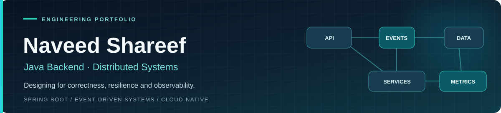

<!-- Profile README: naveed24 | An engineering portfolio, not a resume dump -->

  

  <strong>Java Backend Developer · Software Engineering · Cloud-Native Systems</strong> 
  Hyderabad, India · Building reliable APIs and learning in public

  
  
  

---

## About me

I build backend systems with **Java, Spring Boot, Spring Cloud, SQL and REST APIs**, with growing depth in **distributed systems and platform engineering**.

My focus is not just making an endpoint work. I want to understand what happens when a request is retried, a service becomes unavailable, an event arrives twice, or a deployment needs to be rolled back. My engineering background includes cloud/infrastructure operations, and I bring that operational perspective to application development.

**Currently focused on:** transaction correctness · event-driven architecture · resilient workflows · observability · delivery pipelines.

## Selected engineering work

### 01 / [AegisPay — Distributed Payments & Fraud Detection](https://github.com/naveed24/aegispay-platform)

**Flagship architecture project · Java 21 / Spring Boot / Kafka / PostgreSQL / Redis**

A multi-service payment system designed around the difficult parts of financial workflows: duplicate requests, asynchronous delivery, accounting invariants, and partial failures.

- **Request correctness:** idempotency keys tied to request fingerprints to prevent duplicate payment intent.
- **Event reliability:** transactional outbox and idempotent Kafka consumers.
- **Financial integrity:** immutable, balanced double-entry ledger; asynchronous settlement.
- **Operational design:** HMAC-signed webhooks with retries, health/metrics endpoints, Docker and Kubernetes configuration.

[Repository & local setup](https://github.com/naveed24/aegispay-platform) · [Architecture](https://github.com/naveed24/aegispay-platform/blob/main/docs/architecture/README.md) · [Design decisions (ADRs)](https://github.com/naveed24/aegispay-platform/tree/main/docs/adr)

### 02 / [TradeX — Full-Stack Paper Trading](https://github.com/naveed24/stock-trading-platform)

**Full-stack microservices · Java / Spring Cloud / MySQL / React**

A simulated stock-trading application covering sign-in, demo wallet funding, buy/sell orders, holdings, and portfolio history. It includes gateway-level JWT checks, service discovery, and a React interface backed by real project APIs.

**Engineering trade-off documented:** multi-service trade operations are not yet atomic across databases. The repository explains why a Saga/outbox and stronger idempotency are future work. This is a **paper-trading demo**, not an exchange or real-money product.

[Repository & architecture](https://github.com/naveed24/stock-trading-platform)

### 03 / [FlowForge — Workflow Orchestration](https://github.com/naveed24/flowforge-platform)

**Active build · Java 21 / Spring Boot / PostgreSQL / Flyway**

An evolving workflow platform with DAG validation, persisted run state, idempotent execution submissions, optimistic version checks, paginated history, and durable retry/requeue scheduling.

**Current boundary:** retry state and requeueing exist; Kafka worker dispatch, distributed leases, and task execution remain planned. The README distinguishes the implemented slice from the roadmap.

[Implementation details](https://github.com/naveed24/flowforge-platform) · [Architecture notes](https://github.com/naveed24/flowforge-platform/blob/main/docs/architecture.md)

### 04 / [SentinelOps — Observability & Incident Platform](https://github.com/naveed24/sentinelops-platform)

**Active build · Java 21 / Spring Boot / PostgreSQL / Prometheus**

An operational service registry with REST APIs, persistence, validation, health checks, and Prometheus metrics. Incident lifecycles, alert evaluation, and event ingestion are on the roadmap.

[Repository & roadmap](https://github.com/naveed24/sentinelops-platform)

**Other projects:** [Digital Banking — Spring Cloud microservices](https://github.com/naveed24/Digital-banking-platform) · [PulseGuard — Jenkins CI & containers](https://github.com/naveed24/pulseguard) · [Customer Relationship Manager — Spring CRUD](https://github.com/naveed24/customer-relationship-manager)

---

## Engineering decisions I care about

| Engineering concern | My approach | Example |
| :--- | :--- | :--- |
| Clients retry the same request | Idempotency keys and scoped uniqueness | [AegisPay](https://github.com/naveed24/aegispay-platform), [FlowForge](https://github.com/naveed24/flowforge-platform) |
| Messages may be delivered more than once | Transactional outbox and idempotent consumers | [AegisPay](https://github.com/naveed24/aegispay-platform) |
| Multiple requests race to change state | Persisted state transitions and optimistic version checks | [FlowForge](https://github.com/naveed24/flowforge-platform) |
| Systems need to be operated, not just compiled | Health endpoints, metrics, CI and deployment documentation | [SentinelOps](https://github.com/naveed24/sentinelops-platform), [AegisPay](https://github.com/naveed24/aegispay-platform) |

## Technical toolbox

| Area | Technologies |
| :--- | :--- |
| **Backend** | Java 21, Spring Boot, Spring Cloud, Spring Security, REST APIs, JPA/Hibernate |
| **Data & messaging** | PostgreSQL, MySQL, Redis, Apache Kafka, Flyway |
| **Frontend** | JavaScript, TypeScript, React, HTML/CSS |
| **DevOps & observability** | Linux, Git, Docker, Kubernetes, Jenkins, GitHub Actions, Prometheus, Grafana |
| **Engineering practices** | API design, unit/integration testing, CI, technical documentation, system design |

## Currently building and learning

- **FlowForge:** progressing from persisted execution/retry state toward an actual distributed worker runtime.
- **SentinelOps:** extending the service-registry foundation into incident and alert workflows.
- **System design:** practicing delivery guarantees, consistency boundaries, concurrency control, and failure recovery.

I value clear documentation that distinguishes **what is implemented**, **what is verified**, and **what is still planned**.

---

  <strong>Interested in backend, full-stack or platform engineering collaboration?</strong> 
  <a href="https://www.linkedin.com/in/naveed-shareef-shaik-99bb87341/">LinkedIn</a> ·
  <a href="mailto:naveedshareef.shaik24@gmail.com">naveedshareef.shaik24@gmail.com</a> ·
  <a href="https://github.com/naveed24?tab=repositories">Browse all repositories</a>

